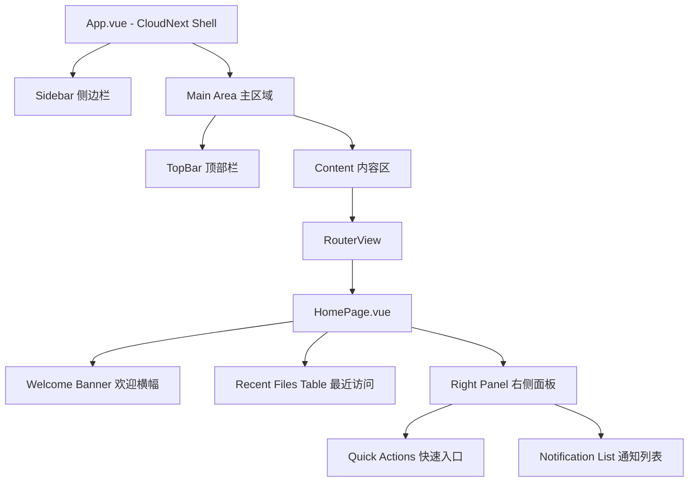

# Design Document

## Overview

本设计文档描述 CloudNext 企业云盘首页 UI 重构的技术方案。重构范围覆盖三个层面：

1. **应用外壳改造（App.vue）**：扩展侧边栏（增加快捷访问、存储空间指示、新建按钮下拉菜单）；改造顶部栏（搜索框 + 通知铃铛 + 用户信息）
2. **首页主内容重构（HomePage.vue）**：欢迎横幅（蓝色渐变 + 统计卡片）+ 最近访问文件列表（带筛选标签和视图切换）
3. **右侧面板新增（HomePage.vue）**：快速入口（2×2 图标按钮）+ 通知列表

所有数据使用静态占位值，不依赖后端 API。复用 `style.css` 中已有的 CSS 自定义属性（design tokens），保持视觉一致性。

**技术栈**：Vue 3 (Composition API + `<script setup>`) + Vite + Vue Router 4

**设计决策**：
- 不引入新的 UI 组件库，保持轻量依赖
- 不拆分为独立子组件文件（当前项目规模较小，单文件组件内通过 template 区块组织即可）
- 响应式断点复用现有 `@media (max-width: 1200px)` 和 `@media (max-width: 960px)`

## Architecture

### 整体布局架构



### CSS Grid 布局结构

```
┌─────────────────────────────────────────────────────┐
│                  CloudNext Shell                      │
├──────────┬──────────────────────────────────────────┤
│          │         TopBar (搜索 + 通知 + 用户)       │
│          ├──────────────────────────────────────────┤
│ Sidebar  │              Content Area                 │
│ 248px    │  ┌────────────────────┬──────────────┐   │
│          │  │  Welcome Banner    │              │   │
│ - 品牌    │  ├────────────────────┤  Right Panel │   │
│ - 新建    │  │                    │  - 快速入口   │   │
│ - 导航    │  │  Recent Files      │  - 通知列表   │   │
│ - 快捷访问│  │  Table             │              │   │
│ - 存储    │  │                    │              │   │
│          │  └────────────────────┴──────────────┘   │
└──────────┴──────────────────────────────────────────┘
```

### 文件变更范围

| 文件 | 变更类型 | 说明 |
|------|---------|------|
| `src/App.vue` | 修改 | 侧边栏扩展 + 顶部栏改造 |
| `src/pages/HomePage.vue` | 重写 | 完全重构为新布局 |
| `src/style.css` | 追加 | 新增组件样式（复用现有 tokens） |
| `src/router/index.js` | 不变 | 路由配置无需修改 |

## Components and Interfaces

### 1. App.vue - 侧边栏改造

#### Template 结构

```html
<aside class="cloudnext-sidebar">
  <!-- 品牌区 -->
  <div class="cloudnext-sidebar-top">
    <div class="brand-block">
      <span class="auth-badge">CloudNext</span>
      <strong class="brand-title">企业云盘</strong>
      <span class="brand-subtitle">Enterprise Cloud Drive</span>
    </div>

    <!-- 新建按钮 + 下拉菜单 -->
    <div class="sidebar-new-action">
      <button class="primary-button sidebar-primary-action">＋ 新建</button>
      <div v-if="showNewMenu" class="sidebar-new-dropdown">
        <button>新建文件夹</button>
        <button>上传文件</button>
      </div>
    </div>

    <!-- 导航菜单 -->
    <nav class="sidebar-nav">
      <RouterLink to="/">⌂ 首页</RouterLink>
      <RouterLink to="/my-files">📄 我的文件</RouterLink>
      <RouterLink to="/shared">🔗 共享文件</RouterLink>
      <RouterLink to="/workspaces">👥 协作空间</RouterLink>
      <RouterLink to="/links">🌐 外链管理</RouterLink>
      <RouterLink to="/trash">🗑 回收站</RouterLink>
    </nav>

    <!-- 快捷访问 -->
    <div class="sidebar-section">
      <span class="sidebar-section-title">快捷访问</span>
      <div class="sidebar-shortcuts">
        <span>⭐ 产品设计资料</span>
        <span>⭐ 市场部资料</span>
        <span>  2024年项目资料</span>
        <span>  企业文化手册</span>
        <span>  培训资料</span>
      </div>
    </div>
  </div>

  <!-- 存储空间指示 -->
  <div class="sidebar-storage">
    <div class="storage-bar">
      <div class="storage-bar-fill" style="width: 24.5%"></div>
    </div>
    <span>已使用 2.45 TB / 10 TB (24.5%)</span>
    <a href="#">管理存储</a>
  </div>
</aside>
```

#### Script 接口

```javascript
// 新增响应式状态
const showNewMenu = ref(false)

// 新建按钮下拉菜单切换
const toggleNewMenu = () => { showNewMenu.value = !showNewMenu.value }

// 点击外部关闭菜单
const closeNewMenu = () => { showNewMenu.value = false }
// 通过 @click.stop 和 document click listener 实现
```

### 2. App.vue - 顶部栏改造

#### Template 结构

```html
<header class="cloudnext-topbar">
  <!-- 搜索框 -->
  <label class="cloudnext-search">
    <input type="text" placeholder="搜索文件、文件夹或团队空间" />
    <span class="search-shortcut">⌘K</span>
  </label>

  <!-- 右侧操作区 -->
  <div class="cloudnext-topbar-actions">
    <!-- 通知铃铛 -->
    <button class="topbar-notification">
      <span class="notification-icon">🔔</span>
      <span class="notification-badge">12</span>
    </button>

    <!-- 用户信息 -->
    <div class="topbar-user">
      <div class="topbar-avatar">张</div>
      <div class="topbar-user-info">
        <strong>张伟</strong>
        <span>产品部</span>
      </div>
    </div>
  </div>
</header>
```

### 3. HomePage.vue - 完全重构

#### Template 结构概览

```html
<section class="homepage">
  <div class="homepage-grid">
    <!-- 左侧主内容列 -->
    <div class="homepage-main">
      <!-- 欢迎横幅 -->
      <div class="welcome-banner">
        <div class="welcome-left">
          <h1>{{ greeting }}</h1>
          <p>{{ dateString }}</p>
        </div>
        <div class="welcome-stats">
          <div class="stat-card">...</div> × 4
        </div>
      </div>

      <!-- 最近访问文件列表 -->
      <section class="recent-files">
        <div class="recent-files-header">
          <h2>最近访问</h2>
          <div class="filter-tabs">...</div>
          <div class="view-toggles">...</div>
        </div>
        <div class="recent-files-table">...</div>
      </section>
    </div>

    <!-- 右侧面板 -->
    <aside class="homepage-side">
      <!-- 快速入口 -->
      <section class="quick-actions-panel">...</section>
      <!-- 通知列表 -->
      <section class="notifications-panel">...</section>
    </aside>
  </div>
</section>
```

#### Script 接口

```javascript
import { ref, computed } from 'vue'

// 欢迎横幅
const userName = ref('张伟')
const greeting = computed(() => {
  const hour = new Date().getHours()
  const name = userName.value ? `，${userName.value}` : ''
  if (hour >= 6 && hour < 12) return `上午好${name}`
  if (hour >= 12 && hour < 18) return `下午好${name}`
  return `晚上好${name}`
})
const dateString = computed(() => {
  const now = new Date()
  const weekdays = ['日', '一', '二', '三', '四', '五', '六']
  return `欢迎回来！今天是 ${now.getFullYear()}年${now.getMonth()+1}月${now.getDate()}日 星期${weekdays[now.getDay()]}`
})

// 统计数据（静态占位）
const stats = ref({
  storage: { used: '2.45 TB', total: '10 TB', percent: 24.5 },
  files: { count: 12680, trend: '+3.2%' },
  shared: { count: 356, trend: '+12.5%' },
  links: { count: 89, trend: '-2.1%' }
})

// 最近访问文件
const activeFilter = ref('all')
const viewMode = ref('list')
const filterTabs = ['全部', '我创建的', '我修改的', '共享给我的']
const recentFiles = ref([...]) // 静态占位数据

// 快速入口
const quickActions = [
  { icon: '⬆', label: '上传文件' },
  { icon: '📁', label: '新建文件夹' },
  { icon: '🔗', label: '创建共享' },
  { icon: '👥', label: '发起协作' }
]

// 通知列表
const notifications = ref([
  { text: '李娜 共享了文件夹 \'市场活动方案\'', time: '今天 10:30' },
  { text: '文件上传完成：2024年宣传视频.mp4 等 3 个文件', time: '今天 09:15' },
  { text: '协作邀请：王强 邀请你加入协作 \'产品优化需求文档\'', time: '昨天 16:40' }
])
```

## Data Models

### 静态数据结构

所有数据为静态占位值，定义在组件内部，无需外部 API 调用。

```typescript
// 统计卡片数据模型
interface StatCard {
  label: string        // 指标名称：存储空间 | 文件数量 | 共享文件 | 外链数量
  value: string        // 主要数值
  secondary: string    // 次要信息（百分比或趋势）
  link?: string        // 可选跳转链接
}

// 最近访问文件数据模型
interface RecentFile {
  id: string
  name: string           // 文件名
  type: 'folder' | 'word' | 'excel' | 'ppt' | 'video' | 'pdf'  // 文件类型
  owner: string          // 所有者姓名
  ownerAvatar: string    // 所有者头像（首字符）
  modifiedTime: string   // 修改时间（展示用字符串）
  size: string           // 文件大小（人类可读格式）
  starred: boolean       // 是否收藏
}

// 通知数据模型
interface Notification {
  id: string
  text: string           // 通知描述
  detail?: string        // 详细信息
  time: string           // 时间戳（相对时间）
}

// 快捷访问项数据模型
interface ShortcutItem {
  name: string           // 文件夹名称
  starred: boolean       // 是否带星标
}

// 存储空间数据模型
interface StorageInfo {
  used: string           // 已使用量 "2.45 TB"
  total: string          // 总量 "10 TB"
  percent: number        // 百分比 24.5
}
```

### 静态占位数据

```javascript
// 最近访问文件列表（静态）
const recentFiles = [
  { id: '1', name: '2024年度营销方案.pptx', type: 'ppt', owner: '张伟', ownerAvatar: '张', modifiedTime: '今天 09:30', size: '15.2 MB', starred: true },
  { id: '2', name: '产品需求文档v3.docx', type: 'word', owner: '李娜', ownerAvatar: '李', modifiedTime: '今天 08:45', size: '2.8 MB', starred: false },
  { id: '3', name: '财务报表Q3.xlsx', type: 'excel', owner: '王强', ownerAvatar: '王', modifiedTime: '昨天 18:20', size: '4.1 MB', starred: true },
  { id: '4', name: '企业宣传视频.mp4', type: 'video', owner: '张伟', ownerAvatar: '张', modifiedTime: '昨天 14:00', size: '256.7 MB', starred: false },
  { id: '5', name: '合同模板.pdf', type: 'pdf', owner: '赵敏', ownerAvatar: '赵', modifiedTime: '2024-12-18 10:30', size: '1.2 MB', starred: false },
  { id: '6', name: '项目资料', type: 'folder', owner: '张伟', ownerAvatar: '张', modifiedTime: '2024-12-17 16:45', size: '--', starred: true }
]

// 快捷访问列表（静态）
const shortcuts = [
  { name: '产品设计资料', starred: true },
  { name: '市场部资料', starred: true },
  { name: '2024年项目资料', starred: false },
  { name: '企业文化手册', starred: false },
  { name: '培训资料', starred: false }
]
```


## Correctness Properties

*A property is a characteristic or behavior that should hold true across all valid executions of a system—essentially, a formal statement about what the system should do. Properties serve as the bridge between human-readable specifications and machine-verifiable correctness guarantees.*

虽然本特性以 UI 渲染和布局为主，但其中包含若干纯函数逻辑（问候语计算、文件大小格式化、时间显示格式选择），适合用属性测试验证其正确性。

### Property 1: Greeting time range correctness

*For any* hour value between 0 and 23 (inclusive), the greeting function SHALL return "上午好" for hours 6–11, "下午好" for hours 12–17, and "晚上好" for hours 18–23 and 0–5. When a username is provided, the greeting SHALL include a comma followed by the username; when the username is empty or null, the greeting SHALL contain only the time-based text without comma or name placeholder.

**Validates: Requirements 6.2, 6.3**

### Property 2: File size formatting correctness

*For any* non-negative number of bytes, the file size formatting function SHALL produce a human-readable string using the appropriate unit (B for < 1024, KB for < 1024², MB for < 1024³, GB for ≥ 1024³), rounded to one decimal place, and the numeric value in the output SHALL be mathematically equivalent to the input bytes divided by the corresponding unit factor (within floating-point tolerance).

**Validates: Requirements 7.7**

### Property 3: Time display format selection

*For any* timestamp, the time display function SHALL use relative format (e.g., "今天 HH:mm", "昨天 HH:mm") when the timestamp is within the last 24 hours from the current time, and SHALL use absolute format "YYYY-MM-DD HH:mm" when the timestamp is more than 24 hours ago. The displayed time values SHALL be consistent with the input timestamp.

**Validates: Requirements 7.7**

## Error Handling

本阶段使用静态占位数据，不涉及网络请求或异步操作，错误处理范围有限：

| 场景 | 处理策略 |
|------|---------|
| 用户姓名不可用 | 问候语省略姓名，仅显示时段问候（需求 6.3） |
| 文件列表为空 | 显示空状态占位提示（需求 7.6） |
| 下拉菜单状态异常 | 点击外部区域强制关闭（需求 1.4） |
| 未知文件类型 | 显示通用文件图标（灰色默认图标） |

### 防御性编码

- `greeting` computed 中对 `userName` 做空值检查
- `formatFileSize` 函数对负数和非数字输入返回 `'--'`
- `formatTime` 函数对无效 Date 输入返回空字符串
- 下拉菜单使用 `v-if` 控制渲染，避免不必要的 DOM 节点

## Testing Strategy

### 测试框架选择

由于当前项目未配置测试框架，建议引入：
- **Vitest**：与 Vite 原生集成，零配置即可运行
- **fast-check**：JavaScript 属性测试库，用于验证 Correctness Properties

### 单元测试（Example-based）

覆盖以下场景：

| 测试目标 | 测试内容 |
|---------|---------|
| 问候语边界值 | hour=5→晚上好, hour=6→上午好, hour=11→上午好, hour=12→下午好, hour=17→下午好, hour=18→晚上好 |
| 文件类型图标映射 | 6 种文件类型各自映射到正确的图标和颜色 |
| 筛选标签切换 | 点击各标签后 activeFilter 状态正确更新 |
| 视图模式切换 | list/grid 切换后 viewMode 状态正确更新 |
| 下拉菜单开关 | 点击按钮打开，点击外部关闭 |
| 空状态显示 | 当筛选结果为空时显示占位提示 |
| 日期格式化 | 今天的时间显示"今天 HH:mm"，昨天显示"昨天 HH:mm"，更早显示完整日期 |
| 文件大小格式化 | 0→"0 B", 1023→"1023 B", 1024→"1.0 KB", 1048576→"1.0 MB" |

### 属性测试（Property-based）

使用 **fast-check** 库，每个属性测试运行最少 100 次迭代：

```javascript
// Feature: cloudnext-homepage-redesign, Property 1: Greeting time range correctness
fc.assert(fc.property(
  fc.integer({ min: 0, max: 23 }),
  fc.option(fc.string({ minLength: 1 })),
  (hour, userName) => {
    const result = getGreeting(hour, userName)
    // 验证时段正确性和姓名包含逻辑
  }
), { numRuns: 100 })

// Feature: cloudnext-homepage-redesign, Property 2: File size formatting correctness
fc.assert(fc.property(
  fc.integer({ min: 0, max: 1099511627776 }), // 0 to 1TB
  (bytes) => {
    const result = formatFileSize(bytes)
    // 验证单位选择和数值正确性
  }
), { numRuns: 100 })

// Feature: cloudnext-homepage-redesign, Property 3: Time display format selection
fc.assert(fc.property(
  fc.date({ min: new Date('2024-01-01'), max: new Date('2025-12-31') }),
  (timestamp) => {
    const result = formatTime(timestamp)
    // 验证相对/绝对格式选择正确性
  }
), { numRuns: 100 })
```

### 组件测试

使用 Vitest + Vue Test Utils 进行组件级测试：

- HomePage 组件渲染完整性（所有区块存在）
- 响应式布局断点验证（模拟 viewport 宽度）
- 交互行为验证（筛选切换、下拉菜单）

### 测试文件组织

```
src/
├── __tests__/
│   ├── homepage.spec.js          # 组件测试
│   ├── greeting.spec.js          # 问候语逻辑单元测试
│   ├── formatters.spec.js        # 格式化函数单元测试
│   └── formatters.property.js    # 属性测试（Property 2, 3）
│   └── greeting.property.js     # 属性测试（Property 1）
```

### 样式策略

#### 复用现有 Design Tokens

所有新增样式必须引用 `style.css` 中已定义的 CSS 自定义属性：

| Token 类别 | 使用场景 |
|-----------|---------|
| `--bg-primary`, `--bg-primary-hover` | 欢迎横幅渐变、主操作按钮 |
| `--bg-panel`, `--bg-panel-soft` | 卡片背景、统计卡片 |
| `--border-color`, `--border-strong` | 面板边框、分隔线 |
| `--text-primary`, `--text-secondary`, `--text-tertiary` | 标题、正文、辅助文字 |
| `--radius-sm`, `--radius-md`, `--radius-lg` | 按钮、卡片、面板圆角 |
| `--shadow-soft` | 面板阴影 |
| `--spacing-1` ~ `--spacing-5` | 内外边距 |
| `--sidebar-width` | 侧边栏宽度 |

#### 新增样式命名规范

遵循现有 BEM-like 命名风格（`组件-元素` 模式）：

```css
/* 欢迎横幅 */
.welcome-banner { }
.welcome-banner-left { }
.welcome-banner-stats { }
.welcome-stat-card { }

/* 最近访问 */
.recent-files { }
.recent-files-header { }
.recent-files-filters { }
.recent-files-table { }

/* 右侧面板 */
.homepage-side { }
.quick-actions-panel { }
.quick-actions-grid { }
.notifications-panel { }
.notification-item { }

/* 侧边栏扩展 */
.sidebar-new-dropdown { }
.sidebar-shortcuts { }
.sidebar-shortcut-item { }
.sidebar-storage { }
.storage-bar { }
.storage-bar-fill { }

/* 顶部栏改造 */
.search-shortcut { }
.topbar-notification { }
.notification-badge { }
.topbar-user { }
.topbar-avatar { }
```

#### 响应式断点

复用现有媒体查询断点，新增组件遵循相同规则：

```css
/* 1200px: 右侧面板折叠到下方 */
@media (max-width: 1200px) {
  .homepage-grid {
    grid-template-columns: 1fr;
  }
  .welcome-banner-stats {
    grid-template-columns: repeat(2, 1fr);
  }
}

/* 960px: 侧边栏折叠 */
@media (max-width: 960px) {
  .cloudnext-shell {
    grid-template-columns: 1fr;
  }
  .welcome-banner {
    flex-direction: column;
  }
  .welcome-banner-stats {
    grid-template-columns: 1fr;
  }
}
```
